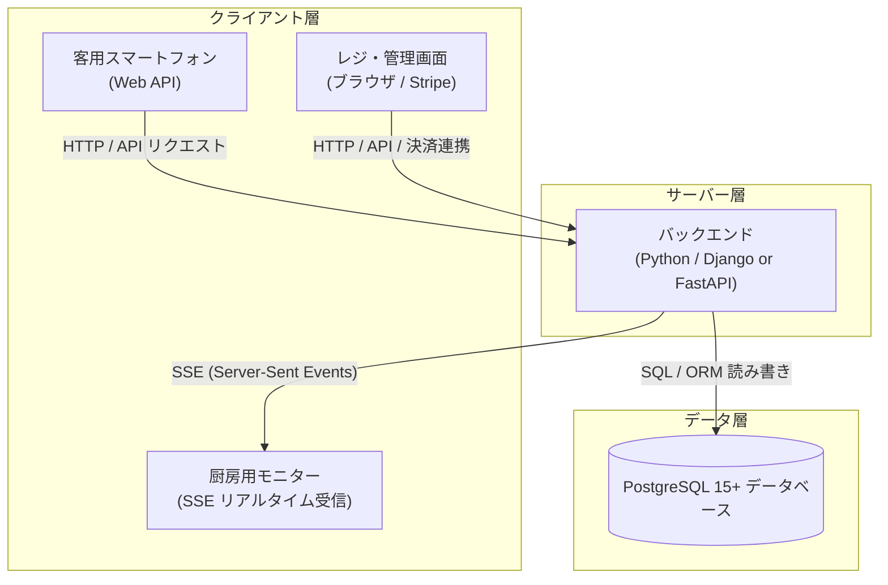
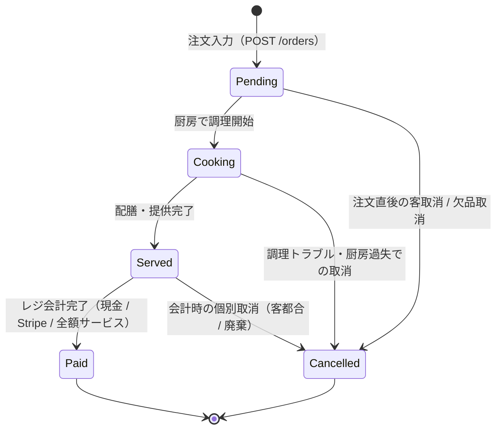
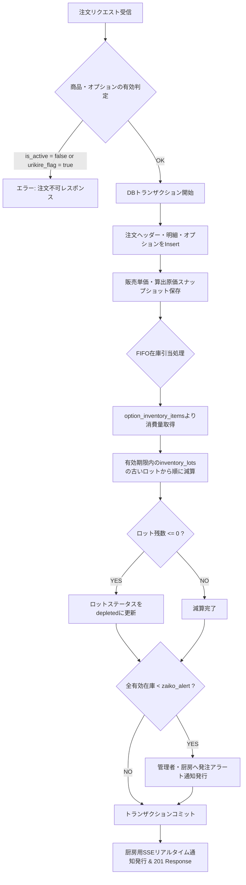

# ラーメン店 店内注文・在庫・店舗管理システム 要件定義・設計仕様書

## 1. システム概要・コンセプト

### 1.1 目的・背景
本システムは、ラーメン店における客席からの注文受付の効率化、厨房への調理指示のリアルタイム化、レジ会計精算の自動化、および先入れ先出し（FIFO）に基づく厳密な在庫・賞味期限・原価・粗利管理を一貫して行う店内注文・店舗管理システムである。

### 1.2 システム構成タイプ
* **客端末モバイルオーダー型**: 各卓上に配置されたQRコードを客自身のスマートフォン（または卓上タブレット）で読み取り、ウェブブラウザ経由で注文を行う（専用アプリのインストール不要）。

---

## 2. システムアーキテクチャ・技術スタック

### 2.1 全体構成図


### 2.2 コンポーネント構成
1. **客用注文画面 (Mobile Order Web App)**: 商品選択、カスタマイズ（硬さ・トッピング等）、注文送信、注文直後の取消、履歴確認
2. **厨房用モニター画面 (Kitchen Display System / KDS)**: 新規注文のリアルタイム受信（SSE）、商品ごとの調理・提供ステータス管理、欠品・手違い取消
3. **レジ・会計画面 (POS Terminal Web App)**: 卓番号選択、伝票確認、個別取消、おごり・サービス割引適用、現金・Stripe決済処理、レシート発行
4. **管理画面 (Admin Dashboard)**: メニューCRUD管理、仕入・ロット管理、在庫追跡、自動発注アラート、売上・粗利・廃棄ロス・販促費分析
5. **バックエンド API / DB**: データ保持、業務ロジック処理（FIFO在庫減算/復元・有効期限チェック・粗利計算）、SSE配信、Stripe連携

### 2.3 技術スタック選定
| レイヤー | 選定技術 | 選定理由・補足 |
|---|---|---|
| **フロントエンド** | **React / Next.js** | 客用スマホ、厨房モニター、レジ、管理画面を単一フレームワークで構築 |
| **バックエンド** | **Python (Django / FastAPI)** | 高速なAPI構築、複雑なFIFO計算・粗利ロジック、Stripe SDK連携 |
| **データベース** | **PostgreSQL 15+** | トランザクション管理、高精度な数値計算、集計クエリに優れる |
| **リアルタイム通信** | **SSE (Server-Sent Events)** | 厨房モニター・レジ・客端末への単方向通知。自動再接続標準装備で安定性が高い |
| **決済基盤** | **Stripe (Stripe Checkout / API)** | クレジットカード決済の安全な処理とAPI連携 |

---

## 3. 業務・機能要件

### 3.1 客用注文機能（モバイルオーダーUI）
* **メニュー表示・制御**:
  * 写真付きメニューによる直感的UI、カテゴリ単位（ラーメン、サイド、セット、トッピング）での商品一覧表示。
  * 季節メニュー等の非表示制御（`is_active`）および手動・在庫連動での緊急品切れ制御（`urikire_flag`）。
* **ラーメンカスタマイズ機能**:
  * 麺のかたさ選択（硬め・普通・柔らかめ ※太さ選択は廃棄ロス削減のため不採用）
  * 味の濃さ・脂の量、量の調整（大盛り・普通盛り・小盛り）
  * トッピング追加（煮卵、チャーシュー、ネギ、バターコーン等）
* **セットメニュー注文**:
  * 独立した商品として選択（半チャーハンセット、半チャーハン餃子セット、ごはんセット、ごはん餃子セット等）。
  * セット内のラーメン種類やカスタマイズ（硬さ等）をモーダルで選択可能。
* **カート＆注文確定**:
  * 卓番号の紐付け、合計金額計算、注文確定送信。
  * 過去の売上データを保証するため、注文確定時の商品単価およびオプション単価をスナップショットとして記録。
* **注文直後の客都合キャンセル機能**:
  * 厨房が「調理中（`cooking`）」ステータスに変更する前の数分間（`pending` 状態）のみ、画面上に **[注文を取り消す]** ボタンを表示。
  * **実行時処理**: 厨房画面（KDS）から該当商品が消去され、一時減算されていた在庫ロット（FIFO）を自動的に復元（加算）する。

### 3.2 厨房モニター（KDS：調理・提供管理）機能
* **リアルタイム通知**: Server-Sent Events (SSE) を用いた即時通知（音＋画面更新）。
* **商品単位（`order_items`）でのステータス管理**:
  * `pending`（受付済・未着手） ➔ `cooking`（調理中） ➔ `served`（提供済）の遷移管理。
  * 一部の商品（例：ラーメン）が先に提供され、別商品（例：餃子）が後から提供される個別提供運用に対応。
* **注文全体（`orders`）ステータスの連動**:
  * 全商品が `served` になった時点で注文全体のステータスを提供完了状態へ遷移。
* **欠品・手違い対応（厨房側取消機能）**:
  * 伝票リストの各商品横に **[欠品・取り消し]** ボタンを配置（誤操作防止のため長押し仕様などを採用）。
  * 材料切れや調理ミス等で提供不可となった場合、厨房から取り消しを実行可能とし、客端末およびレジ画面へリアルタイムで通知する。

### 3.3 レジ・会計（POS・精算処理）機能
* **卓番号別 伝票呼び出し**: 卓番号を選択すると、未会計の注文明細（商品名・単価・数量・小計）と総合計額を表示。
* **会計時個別取消機能**:
  * 会計前に卓の明細リストから商品を個別に **[取消]** 可能とし、取消理由モーダルで理由を選択する。
    1. **客都合（誤注文等 / `customer_mistake`）**: 売上・原価から除外し、在庫ロット数を自動復元（加算）。
    2. **厨房過失・品切れ・廃棄（`kitchen_error` / `out_of_stock`）**: 売上からは除外するが、在庫は戻さず「廃棄ロス（損失）」として計上。
* **おごり・サービス（100%割引・販促）機能**:
  * 大将のおごり、販促イベント（1周年記念餃子無料サービス等）に対応する **[全額サービス / 一部サービス]** ボタンを設置。
  * **伝票全額サービス**: 総合計額を ¥0 に設定し、決済なしで精算完了処理（レシート発行可）。
  * **商品単位サービス**: 該当商品のみを 100%割引（¥0 / `comp` / `100_percent_off`）として処理。
  * **会計・原価扱い**: 売上は ¥0（または割引後額）計上だが、使用した食材の在庫ロットはFIFOで正しく減算し、消費食材の原価は「販売促進費 / 接待交際費（ロス）」として管理画面に記録。
* **決済方式の選択と精算処理**:
  * **現金決済**: 入金額を入力すると「お釣り（入金額 − 総合計）」を自動計算・表示して確定。
  * **クレジットカード・キャッシュレス決済**: Stripe Checkout / Stripe SDK と連携し、安全にカード決済を実行。
* **レシート出力・状態完了化**: 支払い完了時にレシート（サーマルプリンター印字 / 画面表示）を発行し、`orders` のステータスを会計完了（`paid`）へ変更。

### 3.4 在庫・仕入管理機能（先入れ先出し & 賞味期限）
* **仕入・ロット（`inventory_lots`）登録**: 仕入日、使用期限（廃棄日）、入荷数量、総仕入額の登録および1単位あたり仕入単価（`unit_cost`）の自動計算。
* **先入れ先出し（FIFO）自動消費**: 注文発生時、商品・オプションに紐づく在庫消費マスタ（`option_inventory_items`）を参照し、使用期限が有効かつ期限が最も近いロットから自動で数量を減算。
* **賞味期限切れ自動ブロック**: 使用期限が過ぎたロット（`expiration_date < CURRENT_DATE`）は有効在庫から除外。
* **発注・売り切れ自動アラート**:
  * 有効在庫数が発注アラート閾値（`zaiko_alert`）を下回ったら、管理・厨房画面へ自動的に発注警告を通知。
  * 有効在庫数が `0` になったら、対象商品の注文受付を自動停止（売り切れフラグ連動）。

### 3.5 経営管理・粗利・ロス分析機能（ダッシュボード）
* **リアルタイム原価・粗利計算**: 注文確定時に消費されたロットの仕入単価から原価スナップショット（`cost_price`）を算出し、（販売価格 − 算出原価）による正確な粗利益を算出。
* **売上・粗利・ロス分析ダッシュボード**:
  * 日次・月次の売上高、原価高、粗利益率、平均客単価の可視化、および商品別・カテゴリ別の粗利貢献度分析。
  * キャンセル・廃棄ロスの内訳追跡（客誤注文数、厨房調理失敗数、品切れ数、廃棄ロス損金）。
  * サービス・おごり・販促イベントによる「販促費 / 交際費ロス金額」の正確な集計。

---

## 4. 特殊オペレーションにおける処理マトリクス

キャンセル・割引などのイレギュラー発生時における、在庫・売上・原価の連動ルールは以下の通りとする。

| イレギュラー事例 | 操作画面 | 在庫ロット（FIFO） | 売上計上 | 原価・損失計上 |
|---|---|---|---|---|
| **注文直後の客ミス** | 客用UI | 復元（加算） | ¥0 | 計上なし |
| **会計時の客キャンセル** | レジUI | 復元（加算） | ¥0 | 計上なし |
| **厨房での失敗・品切れ** | KDS / レジUI | 復元しない（減算のまま） | ¥0 | 廃棄ロス（原価計上） |
| **大将おごり / サービス品** | レジUI | 通常通り減算 | ¥0（割引後額） | 販売促進費 / 接待交際費 |

---

## 5. 非機能要件・データ整合性・運用方針

1. **単価・原価のスナップショット保存**:
   マスター価格（`products.price`, `options.price`）や仕入単価が改定されても過去の売上・粗利・ロスデータを保証するため、`order_items` および `order_item_options` に注文確定時点の金額を記録する。
2. **公開状態と売り切れの分離制御**:
   * `is_active = FALSE`: メニュー画面に非表示（季節限定・取扱終了など）。
   * `urikire_flag = TRUE`: メニュー画面には表示されるが「本日完売」として選択不可。
3. **耐障害性・自動再接続**:
   厨房やレジ端末のWi-Fi一時切断時、SSEの自動再接続機能により復旧後に即座に最新状態を取得する。
4. **夜間バッチ処理**:
   毎日深夜に期限切れロット（`expiration_date < CURRENT_DATE`）を自動検知し、`status = 'expired'` へ更新して有効在庫から切り離す。
5. **決済セキュリティ**:
   クレジットカード情報は自社サーバーやDBで一切保持せず、すべてStripeのセキュアな基盤に委任する。

---

## 6. データベース（DB）設計

### 6.1 テーブル定義一覧

#### ① メニュー・商品管理
* **`categories` (カテゴリマスタ)**
  | カラム名 | 型 | 制約 | 説明 |
  |---|---|---|---|
  | `id` | SERIAL | PRIMARY KEY | カテゴリID |
  | `name` | VARCHAR(50) | NOT NULL | カテゴリ名（ラーメン, サイド, セット, トッピング） |
  | `sort_order` | INT | NOT NULL DEFAULT 0 | 画面の表示順 |
  | `created_at` | TIMESTAMPTZ | DEFAULT CURRENT_TIMESTAMP | 作成日時 |

* **`products` (商品マスタ)**
  | カラム名 | 型 | 制約 | 説明 |
  |---|---|---|---|
  | `id` | SERIAL | PRIMARY KEY | 商品ID |
  | `category_id` | INT | NOT NULL, FK (`categories.id`) | カテゴリID |
  | `name` | VARCHAR(100) | NOT NULL | 商品名（例: 豚骨ラーメン, 半チャーハンセット） |
  | `price` | INT | NOT NULL DEFAULT 0 | 販売価格 (税込) |
  | `urikire_flag` | BOOLEAN | NOT NULL DEFAULT FALSE | 売り切れフラグ（TRUEで完売表示） |
  | `is_active` | BOOLEAN | NOT NULL DEFAULT TRUE | 有効フラグ（FALSEで非表示） |
  | `created_at` | TIMESTAMPTZ | DEFAULT CURRENT_TIMESTAMP | 作成日時 |

#### ② オプション（こだわり・トッピング）管理
* **`option_groups` (オプショングループ)**
  | カラム名 | 型 | 制約 | 説明 |
  |---|---|---|---|
  | `id` | SERIAL | PRIMARY KEY | オプショングループID |
  | `name` | VARCHAR(100) | NOT NULL | グループ名（例: 麺のかたさ, 味の濃さ, 追加トッピング, 量の調整） |
  | `hissu_flag` | BOOLEAN | NOT NULL DEFAULT FALSE | 必須選択フラグ（かたさはTRUE, トッピングはFALSE） |
  | `multi_flag` | BOOLEAN | NOT NULL DEFAULT FALSE | 複数選択フラグ（単一選択はFALSE, 追加トッピングはTRUE） |

* **`options` (オプション選択肢マスタ)**
  | カラム名 | 型 | 制約 | 説明 |
  |---|---|---|---|
  | `id` | SERIAL | PRIMARY KEY | オプションID |
  | `option_group_id` | INT | NOT NULL, FK (`option_groups.id`) | オプショングループID |
  | `name` | VARCHAR(100) | NOT NULL | オプション名（例: 硬め, 普通, 大盛り, 煮卵） |
  | `price` | INT | NOT NULL DEFAULT 0 | 追加料金（例: 煮卵 +100, 大盛り +100, 硬め +0） |
  | `linked_product_id` | INT | NULL, FK (`products.id`) | セットの中身（餃子3個、半チャーハン1個など） |

* **`product_option_groups` (商品・オプショングループ中間テーブル)**
  | カラム名 | 型 | 制約 | 説明 |
  |---|---|---|---|
  | `product_id` | INT | PK, FK (`products.id`) | 商品ID |
  | `option_group_id` | INT | PK, FK (`option_groups.id`) | オプショングループID |

#### ③ 在庫管理
* **`inventory_items` (在庫品目マスタ)**
  | カラム名 | 型 | 制約 | 説明 |
  |---|---|---|---|
  | `id` | SERIAL | PRIMARY KEY | 品目ID |
  | `name` | VARCHAR(100) | NOT NULL | 品目名（例: 基本の麺, チャーシュー） |
  | `tani` | VARCHAR(20) | NOT NULL | 単位（例: 玉, g, 本） |
  | `zaiko_alert` | NUMERIC(10,2) | NOT NULL DEFAULT 0 | 発注アラートを出す有効在庫数の閾値（例: 30） |

* **`inventory_lots` (入荷・在庫ロットテーブル)**
  | カラム名 | 型 | 制約 | 説明 |
  |---|---|---|---|
  | `id` | SERIAL | PRIMARY KEY | ロットID |
  | `inventory_item_id` | INT | NOT NULL, FK (`inventory_items.id`) | 品目ID |
  | `received_date` | DATE | NOT NULL | 仕入日 |
  | `expiration_date` | DATE | NOT NULL | 使用期限（廃棄日） |
  | `initial_quantity` | NUMERIC(10,2) | NOT NULL | 入荷時数量 |
  | `current_quantity` | NUMERIC(10,2) | NOT NULL | 現在の残数量 |
  | `total_cost` | NUMERIC(10,2) | NOT NULL DEFAULT 0 | 総仕入額（円） |
  | `unit_cost` | NUMERIC(10,2) | NOT NULL DEFAULT 0 | 1単位あたり仕入単価 |
  | `status` | VARCHAR(20) | NOT NULL DEFAULT 'active' | `active`(使用可能), `depleted`(使い切り), `expired`(期限切れ廃棄) |

* **`option_inventory_items` (オプション在庫消費中間テーブル)**
  | カラム名 | 型 | 制約 | 説明 |
  |---|---|---|---|
  | `option_id` | INT | PK, FK (`options.id`) | オプションID |
  | `inventory_item_id` | INT | PK, FK (`inventory_items.id`) | 品目ID |
  | `consumed_quantity` | NUMERIC(10,2) | NOT NULL | 1注文あたりの在庫消費量 |

#### ④ 注文・会計管理
* **`orders` (注文・会計ヘッダー)**
  | カラム名 | 型 | 制約 | 説明 |
  |---|---|---|---|
  | `id` | SERIAL | PRIMARY KEY | 注文ID |
  | `table_number` | INT | NOT NULL | 卓番号 |
  | `status` | VARCHAR(20) | NOT NULL DEFAULT 'cooking' | `pending`(受付), `cooking`(調理中), `served`(提供済), `paid`(会計済), `cancelled`(取消) |
  | `total_price` | INT | NOT NULL DEFAULT 0 | 注文総合計金額 |
  | `payment_method` | VARCHAR(20) | NULL | 決済方法（`cash`: 現金, `credit`: カード） |
  | `paid_amount` | INT | NULL | 入金額（現金決済時） |
  | `change_amount` | INT | NULL | お釣り（現金決済時） |
  | `stripe_payment_intent_id` | VARCHAR(100) | NULL | Stripe決済ID |
  | `created_at` | TIMESTAMPTZ | DEFAULT CURRENT_TIMESTAMP | 注文日時 |
  | `paid_at` | TIMESTAMPTZ | NULL | 会計完了日時 |

* **`order_items` (注文明細)**
  | カラム名 | 型 | 制約 | 説明 |
  |---|---|---|---|
  | `id` | SERIAL | PRIMARY KEY | 明細ID |
  | `order_id` | INT | NOT NULL, FK (`orders.id`) ON DELETE CASCADE | 注文ID |
  | `product_id` | INT | NOT NULL, FK (`products.id`) | 商品ID |
  | `price` | INT | NOT NULL | 注文時点の販売単価スナップショット |
  | `cost_price` | INT | NOT NULL DEFAULT 0 | 注文時点の算出原価スナップショット |
  | `quantity` | INT | NOT NULL DEFAULT 1 | 数量 |
  | `status` | VARCHAR(20) | NOT NULL DEFAULT 'pending' | `pending`(注文受領・調理前), `cooking`(調理中), `served`(提供済), `cancelled`(取消済) |
  | `cancel_reason` | VARCHAR(30) | NULL | 取消理由（`customer_mistake`: 客都合誤注文➔在庫復元, `kitchen_error`: 厨房失敗/廃棄➔損失計上, `out_of_stock`: 品切れ➔在庫変更なし） |
  | `discount_type` | VARCHAR(30) | NULL | 割引種別（`comp`, `100_percent_off` 等） |
  | `discount_amount` | INT | NOT NULL DEFAULT 0 | 割引額 |

* **`order_item_options` (注文明細オプション選択)**
  | カラム名 | 型 | 制約 | 説明 |
  |---|---|---|---|
  | `id` | SERIAL | PRIMARY KEY | 選択オプションID |
  | `order_item_id` | INT | NOT NULL, FK (`order_items.id`) ON DELETE CASCADE | 注文明細ID |
  | `option_id` | INT | NOT NULL, FK (`options.id`) | 選択されたオプションID |
  | `price` | INT | NOT NULL | 注文時点のオプション単価スナップショット |

### 6.2 PostgreSQL DDL（テーブル作成SQL）
```sql
-- 1. カテゴリマスタ
CREATE TABLE categories (
    id SERIAL PRIMARY KEY,
    name VARCHAR(50) NOT NULL,
    sort_order INT NOT NULL DEFAULT 0,
    created_at TIMESTAMP WITH TIME ZONE DEFAULT CURRENT_TIMESTAMP
);

-- 2. 商品マスタ
CREATE TABLE products (
    id SERIAL PRIMARY KEY,
    category_id INT NOT NULL REFERENCES categories(id),
    name VARCHAR(100) NOT NULL,
    price INT NOT NULL DEFAULT 0,
    urikire_flag BOOLEAN NOT NULL DEFAULT FALSE,
    is_active BOOLEAN NOT NULL DEFAULT TRUE,
    created_at TIMESTAMP WITH TIME ZONE DEFAULT CURRENT_TIMESTAMP
);

-- 3. オプショングループ
CREATE TABLE option_groups (
    id SERIAL PRIMARY KEY,
    name VARCHAR(100) NOT NULL,
    hissu_flag BOOLEAN NOT NULL DEFAULT FALSE,
    multi_flag BOOLEAN NOT NULL DEFAULT FALSE
);

-- 4. オプション選択肢マスタ
CREATE TABLE options (
    id SERIAL PRIMARY KEY,
    option_group_id INT NOT NULL REFERENCES option_groups(id),
    name VARCHAR(100) NOT NULL,
    price INT NOT NULL DEFAULT 0,
    linked_product_id INT REFERENCES products(id)
);

-- 5. 商品とオプショングループの中間テーブル
CREATE TABLE product_option_groups (
    product_id INT NOT NULL REFERENCES products(id),
    option_group_id INT NOT NULL REFERENCES option_groups(id),
    PRIMARY KEY (product_id, option_group_id)
);

-- 6. 在庫品目マスタ
CREATE TABLE inventory_items (
    id SERIAL PRIMARY KEY,
    name VARCHAR(100) NOT NULL,
    tani VARCHAR(20) NOT NULL,
    zaiko_alert NUMERIC(10, 2) NOT NULL DEFAULT 0
);

-- 7. 在庫ロットテーブル
CREATE TABLE inventory_lots (
    id SERIAL PRIMARY KEY,
    inventory_item_id INT NOT NULL REFERENCES inventory_items(id),
    received_date DATE NOT NULL,
    expiration_date DATE NOT NULL,
    initial_quantity NUMERIC(10, 2) NOT NULL,
    current_quantity NUMERIC(10, 2) NOT NULL,
    total_cost NUMERIC(10, 2) NOT NULL DEFAULT 0,
    unit_cost NUMERIC(10, 2) NOT NULL DEFAULT 0,
    status VARCHAR(20) NOT NULL DEFAULT 'active' CHECK (status IN ('active', 'depleted', 'expired'))
);

-- 8. オプションと在庫消費の中間テーブル
CREATE TABLE option_inventory_items (
    option_id INT NOT NULL REFERENCES options(id),
    inventory_item_id INT NOT NULL REFERENCES inventory_items(id),
    consumed_quantity NUMERIC(10, 2) NOT NULL,
    PRIMARY KEY (option_id, inventory_item_id)
);

-- 9. 注文ヘッダー（レジ・決済情報を統合）
CREATE TABLE orders (
    id SERIAL PRIMARY KEY,
    table_number INT NOT NULL,
    status VARCHAR(20) NOT NULL DEFAULT 'cooking' CHECK (status IN ('pending', 'cooking', 'served', 'paid', 'cancelled')),
    total_price INT NOT NULL DEFAULT 0,
    payment_method VARCHAR(20),                -- 'cash', 'credit'
    paid_amount INT,                           -- 入金額（現金）
    change_amount INT,                         -- お釣り（現金）
    stripe_payment_intent_id VARCHAR(100),     -- Stripe決済ID
    created_at TIMESTAMP WITH TIME ZONE DEFAULT CURRENT_TIMESTAMP,
    paid_at TIMESTAMP WITH TIME ZONE           -- 会計完了日時
);

-- 10. 注文明細（原価スナップショット・キャンセル理由・割引を統合）
CREATE TABLE order_items (
    id SERIAL PRIMARY KEY,
    order_id INT NOT NULL REFERENCES orders(id) ON DELETE CASCADE,
    product_id INT NOT NULL REFERENCES products(id),
    price INT NOT NULL,                        -- 販売単価スナップショット
    cost_price INT NOT NULL DEFAULT 0,         -- 算出原価スナップショット
    quantity INT NOT NULL DEFAULT 1,
    status VARCHAR(20) NOT NULL DEFAULT 'pending' CHECK (status IN ('pending', 'cooking', 'served', 'cancelled')),
    cancel_reason VARCHAR(30),                 -- 'customer_mistake', 'kitchen_error', 'out_of_stock'
    discount_type VARCHAR(30),                 -- 'comp', '100_percent_off' 等
    discount_amount INT NOT NULL DEFAULT 0     -- 割引額
);

-- 11. 注文明細オプション選択
CREATE TABLE order_item_options (
    id SERIAL PRIMARY KEY,
    order_item_id INT NOT NULL REFERENCES order_items(id) ON DELETE CASCADE,
    option_id INT NOT NULL REFERENCES options(id),
    price INT NOT NULL                         -- 注文時点のオプション単価スナップショット
);
```

---

## 7. 主要 API 仕様

### 7.1 メニュー取得 API
* **Endpoint**: `GET /api/v1/menu`
* **Summary**: 有効なカテゴリ・商品およびオプショングループ一覧を取得する。
* **Response (200 OK)**:
```json
{
  "categories": [
    {
      "id": 1,
      "name": "ラーメン",
      "sort_order": 1,
      "products": [
        {
          "id": 1,
          "name": "白ラーメン（豚骨）",
          "price": 800,
          "urikire_flag": false,
          "option_groups": [
            {
              "id": 1,
              "name": "麺のかたさ",
              "hissu_flag": true,
              "multi_flag": false,
              "options": [
                { "id": 101, "name": "硬め", "price": 0 },
                { "id": 102, "name": "普通", "price": 0 }
              ]
            }
          ]
        }
      ]
    }
  ]
}
```

### 7.2 注文作成 API
* **Endpoint**: `POST /api/v1/orders`
* **Summary**: 客用端末から新規注文を発行し、FIFO在庫引当およびSSE通知を行う。
* **Request Body**:
```json
{
  "table_number": 3,
  "items": [
    {
      "product_id": 1,
      "quantity": 1,
      "options": [101, 202, 302]
    },
    {
      "product_id": 4,
      "quantity": 1,
      "options": []
    }
  ]
}
```
* **Response (201 Created)**:
```json
{
  "order_id": 100,
  "status": "pending",
  "total_price": 1040,
  "created_at": "2026-08-02T13:50:00Z"
}
```

### 7.3 注文ステータス更新 API（厨房モニター・取消用）
* **Endpoint**: `PATCH /api/v1/orders/{order_id}/status`
* **Summary**: 注文全体または注文明細単位の調理・提供・取消ステータスを更新する（取消時は `cancel_reason` に応じてFIFO在庫復元または廃棄ロス計上を実行）。
* **Request Body**:
```json
{
  "status": "cooking",
  "order_item_id": 500
}
```
* **Response (200 OK)**:
```json
{
  "order_id": 100,
  "order_item_id": 500,
  "status": "cooking"
}
```

---

## 8. 状態遷移・処理フロー図

### 8.1 注文・会計ステータス遷移（`orders` / `order_items`）


### 8.2 注文確定時の在庫引当・アラート処理フロー
